<p align="center"></p>

**From raw document to reviewed data — on your own machine.** LETRANIX imports PDFs, scans, photos and text files, runs **local OCR**, extracts **typed fields with per-field evidence**, sends every result through **assisted human review**, **learns from the corrections** in a way that is measured, and delivers approved records to external systems through an **idempotent outbox** — with a complete audit trail.

> Source-available portfolio project. No open-source license is granted (see [rights](docs/THIRD_PARTY.md)). All documents, names and figures in this repository are synthetic. [Português](docs/README_PT.md)


## Key features

| | |
|---|---|
| **Document hub** | Drag-and-drop or folder-inbox import, SHA-256 deduplication, full-text search (SQLite FTS5) over names, OCR text and field values, filters by type/status/date/issues, pagination, batch processing, archive and confirmed deletion, CSV/JSON export. |
| **OCR pipeline** | Content-based format detection (PDF, PNG, JPEG, multi-page TIFF, WebP, UTF-8 text), embedded PDF text when present, rendering of scanned PDF pages, measured preprocessing (grayscale, contrast, median denoise, deskew, upscaling), automatic 90/180/270° orientation recovery, background job queue with progress, cancellation and crash recovery. |
| **Structured extraction** | Template-driven fields (`text`, `identifier`, `date`, `number`, `money`, `enum`), label variants, accent/space-tolerant matching, forms with the value *below* the label, line-item tables, date/amount normalisation, regex/enum validation, ambiguity detection. Every value states whether it was **read from a label**, **inferred** or **not found** — nothing is invented. |
| **Assisted review** | Page viewer with OCR boxes and evidence highlighting, low-confidence lines flagged, candidate pickers, inconsistency flags, editable tables, drafts that survive reloads, approve/reject with reason, reopen, per-field provenance (`confirmed` / `corrected` / `entered`). |
| **Learning from review** | Corrections become rules (new labels, recurring value fixes, OCR character confusions) that activate after N confirmations and disable themselves when contradicted; a Naive Bayes classifier learns document types from approvals. **Measured: test field accuracy 54.4% → 95.3%, 0 invented values.** |
| **Integrations** | Adapter contract (`letranix.record/v1`), persistent outbox, retries with exponential backoff, permanent vs transient failures, idempotency keys, a local ledger and a real HTTP adapter against a bundled fictitious records API. |
| **Audit & settings** | Global, filterable audit of every operation (identifiers only, never document text); validated settings that change behaviour; backup and safe restore; versioned database migrations. |
| **Desktop** | Tauri 2 shell that starts and stops the local service itself; no IPC, filesystem or shell capabilities granted to the webview. |

## Gallery

| Overview | Documents | Fields and line items |
|---|---|---|
| 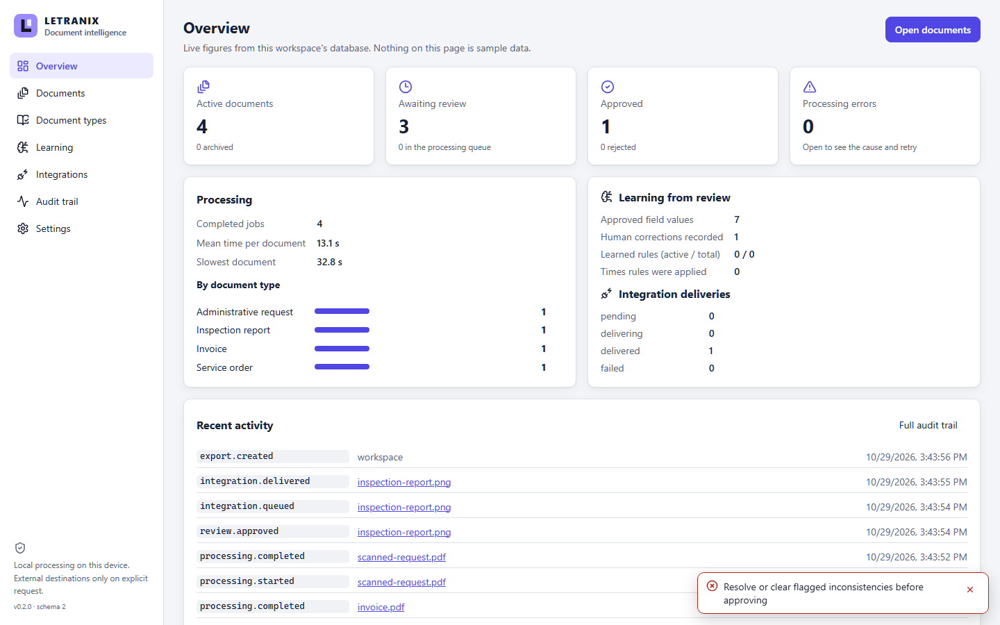 | 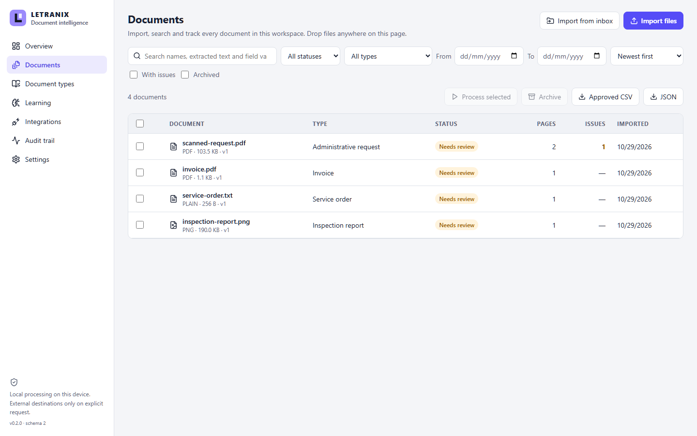 | 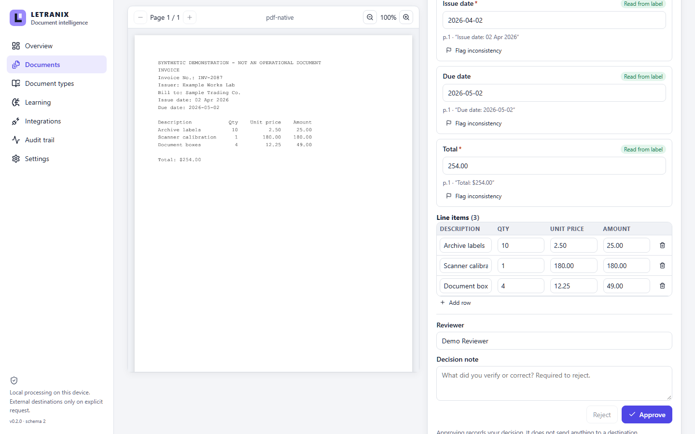 |
| **Review history** | **Integrations** | **Learning** |
| 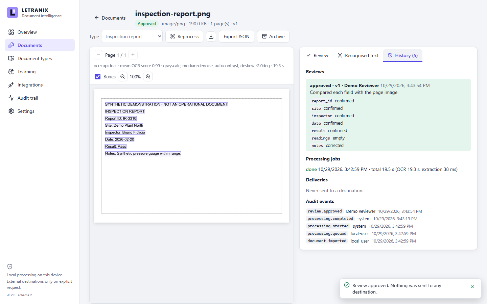 | 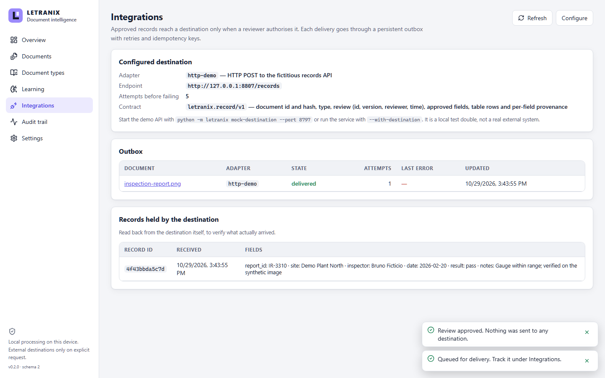 | 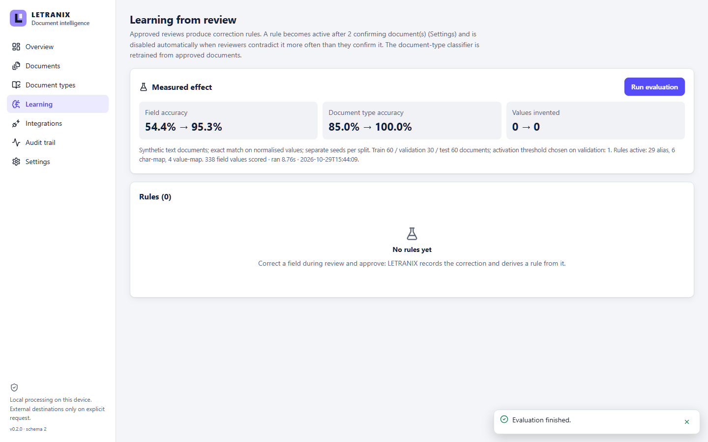 |
| **Audit trail** | **Document types** | **Settings** |
| 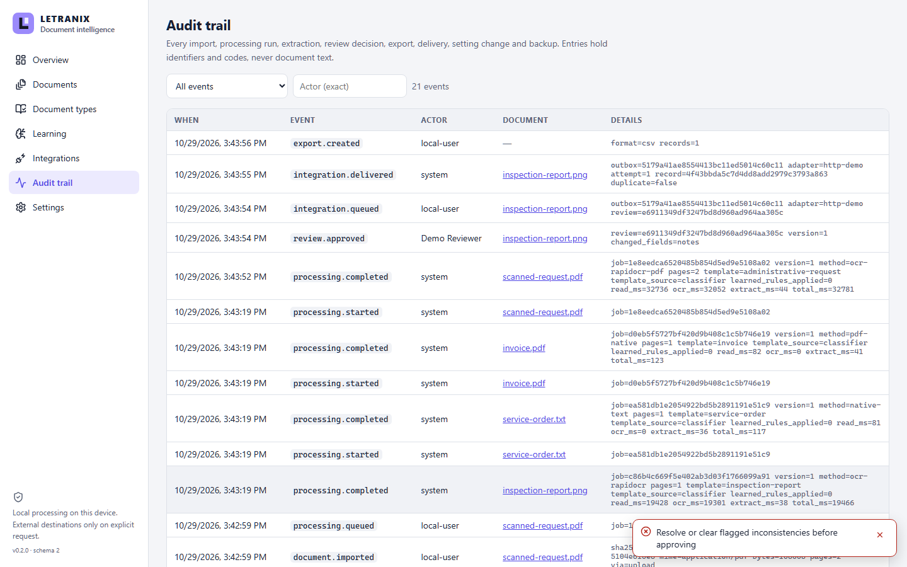 | 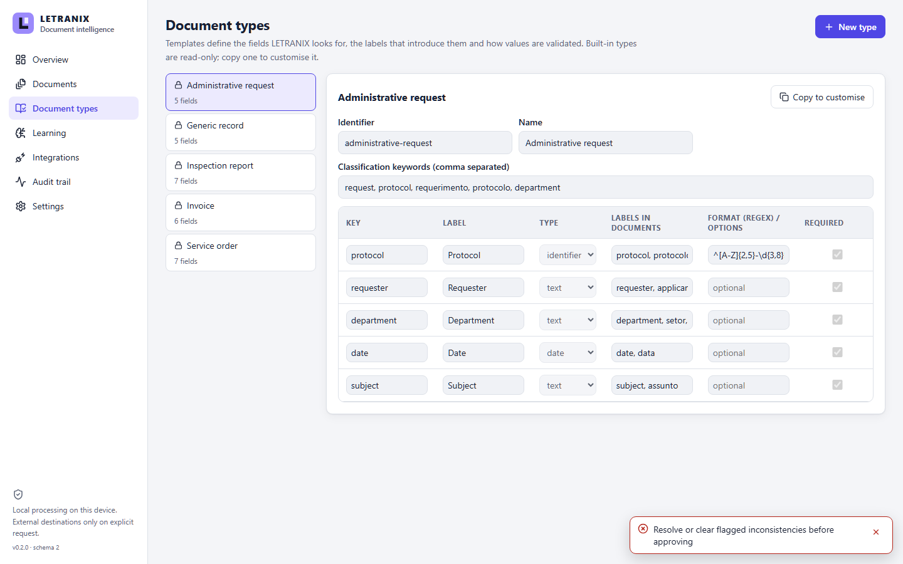 | 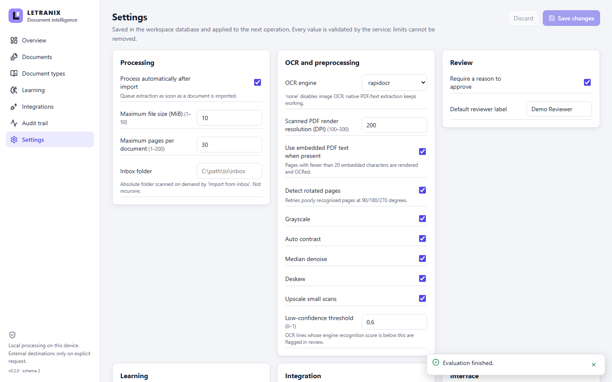 |

All screenshots are captured automatically by the end-to-end test suite (`LETRANIX_SCREENSHOTS=1 npm run test:e2e`) from a fresh workspace using generated synthetic documents.

## OCR in action

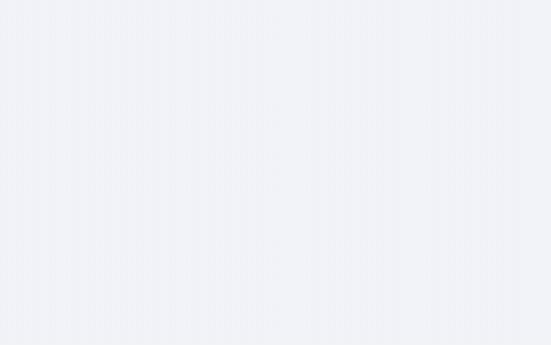

The animation is a 2.5× speed-up of a real recorded Playwright run (no mock-ups): four synthetic documents are imported, processed in the background queue — including a two-page scanned PDF — then reviewed and delivered. In the review screenshot above, the page was deskewed by −2.0°, each OCR line has a box with the engine's own recognition score, and the focused field's evidence is highlighted on the page.

## Assisted review

1. Each field shows its value, where it came from (page, line, box), the rule that produced it and any issues (missing, invalid format, ambiguous, low OCR score).
2. The reviewer corrects, picks a candidate or flags an inconsistency; edits are kept as a local draft until a decision is saved.
3. Approval validates every field against the document type (required, format, allowed options) and refuses while a flag is open; rejection requires a reason.
4. The decision stores per-field provenance and, if approved, feeds the learning rules. Approval **never** sends data anywhere — delivery is a separate, explicit authorisation.

See [docs/REVIEW_WORKFLOW.md](docs/REVIEW_WORKFLOW.md).

## Architecture

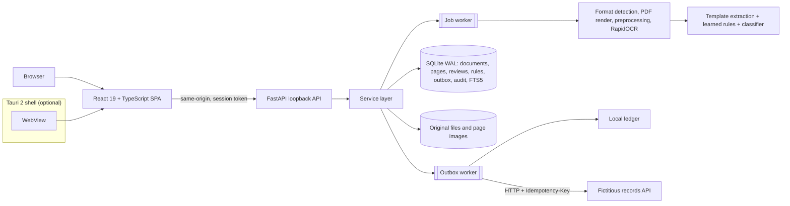

More diagrams (OCR pipeline, review state machine, data model, delivery sequence) in [docs/ARCHITECTURE.md](docs/ARCHITECTURE.md).

## Technologies

Python 3.12 · FastAPI · SQLite (WAL, FTS5, versioned migrations) · RapidOCR on ONNX Runtime (CPU, offline) · pypdf + pypdfium2 · Pillow/NumPy · React 19 · TypeScript · Vite · Tauri 2 (Rust) · pytest · Playwright · Ruff · Bandit · ESLint · Prettier · Gitleaks · pip-audit.

## Installation

Windows, Python 3.12, Node 24. Rust and WebView2 are needed only for the desktop shell.

```powershell
py -3.12 -m venv .venv
.\.venv\Scripts\python.exe -m pip install -r requirements-lock.txt
npm ci
npm run build
```

`requirements.txt` is the minimal runtime set; `requirements-ocr.txt` adds the OCR engine; `requirements-lock.txt` is the exact validated environment.

## Running

```powershell
.\.venv\Scripts\python.exe -m letranix demo                       # generate and import six synthetic documents
.\.venv\Scripts\python.exe -m letranix serve --with-destination   # http://127.0.0.1:8795 (+ demo API on :8797)
```

Desktop: `cargo build --manifest-path src-tauri/Cargo.toml`, then run `src-tauri\target\debug\letranix-desktop.exe` — it reuses a running service or starts one from `.venv` and stops it on exit. Other commands: `letranix evaluate` (learning benchmark), `letranix benchmark` (OCR preprocessing), `letranix mock-destination`. Details in [docs/GETTING_STARTED.md](docs/GETTING_STARTED.md).

## Tests

| Suite | Command | Last local result |
|---|---|---|
| Backend: unit, service, API, real OCR, real HTTP integration, migration, backup | `python -m pytest -q` | **75 passed** |
| Browser end-to-end on a fresh workspace | `npm run test:e2e` | **3 passed** |
| Static checks | `npm run typecheck`, `npm run lint`, `npm run format:check`, `ruff check`, `bandit -r letranix` | clean |
| Learning benchmark | `python -m letranix evaluate` | [learning.json](docs/evaluation/learning.json) |
| OCR preprocessing benchmark | `python -m letranix benchmark` | [ocr-preprocessing.json](docs/evaluation/ocr-preprocessing.json) |
| Performance | `python scripts/perf.py` | [performance.json](docs/evaluation/performance.json) |

What each test covers, what is *not* covered and the measured figures are in [docs/VALIDATION.md](docs/VALIDATION.md). A feature-by-feature status matrix is in [docs/CAPABILITIES.md](docs/CAPABILITIES.md).

## Security and privacy

- Binds to `127.0.0.1` only; Host and Origin checks, per-start session token, no CORS, strict CSP, `nosniff`, attachment downloads.
- No document content leaves the machine. The only outbound HTTP is the explicit delivery to an endpoint restricted to loopback, without redirects.
- Storage paths are generated identifiers; uploads are size/page/pixel bounded before parsing; damaged files are rejected at import.
- Parameterised SQL and quoted FTS terms; CSV export neutralises formula injection; backup restore validates archive members.
- Audit entries contain identifiers and codes, never document text (asserted by a test).

Limits and the threat model are in [docs/SECURITY.md](docs/SECURITY.md).

## Roadmap

- Sandboxed parsing with CPU/memory budgets per document.
- Encrypted workspace storage and authenticated multi-user reviewers.
- Packaged installer with an embedded Python runtime (blocked today, see limitations).
- A second OCR engine (Tesseract) behind the existing engine setting, with a comparative benchmark.
- Handwriting evaluation on a licensed or self-collected dataset.

## Known limitations

- **OCR quality**: the bundled PP-OCR model sometimes drops spaces in large text; only `lowercaseUppercase` boundaries are repaired ("CarlaModelo" → "Carla Modelo"), while lowercase run-ons remain for the reviewer. Handwriting is not evaluated. The preprocessing benchmark uses 10 synthetic images — enough to pick defaults, not to claim general accuracy.
- **Learning** is rule- and statistics-based (aliases, value/character maps, Naive Bayes). It is not a neural model and is measured only on synthetic data.
- **Single user, single process per workspace**; reviewer names are self-declared; storage is not encrypted; parsers are not sandboxed.
- **Desktop**: the shell needs the repository's `.venv` (no embedded Python). Desktop binary distribution remains blocked by a documented build-time Rust advisory (`block-buffer 0.10.4` through `tauri-codegen`); no installer is published.
- **Rights**: no open-source license is granted; see [docs/THIRD_PARTY.md](docs/THIRD_PARTY.md).
