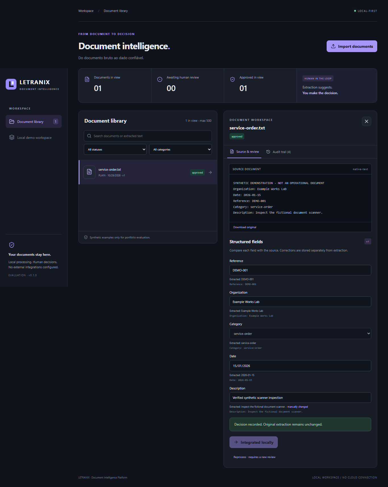
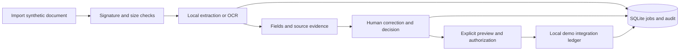

# LETRANIX — Document Intelligence Platform

**Do documento bruto ao dado confiável.**

A local-first document workspace that turns raw text, PDFs and images into structured fields, then requires a recorded human decision before an explicit local demonstration integration.

**Source-only portfolio preview. No open-source license has been granted. Desktop binary distribution remains blocked by a documented build dependency advisory; see [security](docs/SECURITY.md).** [Português](docs/README_PT.md) · [Setup](docs/GETTING_STARTED.md) · [Validation](docs/VALIDATION.md)



## What works

- Import UTF-8 text, native-text PDF, PNG and JPEG; identify content signatures, deduplicate by SHA-256 and store originals under generated identifiers.
- Local image OCR with an optional RapidOCR/ONNX Runtime installation. No document is submitted to an external service.
- Extract five labeled fields: reference, organization, category, date and description. Flag repeated labels and missing evidence without inventing accuracy percentages.
- Search document names and extracted text; filter by extraction category or workflow status.
- Compare the source with extracted fields, correct values, approve or reject with reviewer/reason, and preserve both automatic and human results.
- Preview all approved fields before explicitly creating a record in the local demo ledger. Approval alone never integrates.
- Persist processing jobs, review versions and an application-level audit trail in SQLite; reject stale decisions and repeated integration.
- Responsive React UI; optional Tauri 2 desktop window connecting to the separately running local service.

## Quick start — Windows / Python 3.12 / Node 24

```powershell
py -3.12 -m venv .venv
.\.venv\Scripts\python.exe -m pip install --upgrade pip==26.2.2
.\.venv\Scripts\python.exe -m pip install -r requirements-lock.txt
npm ci
npm run build
.\.venv\Scripts\python.exe -m letranix demo
.\.venv\Scripts\python.exe -m letranix serve
```

Open [http://127.0.0.1:8795](http://127.0.0.1:8795). The demo command generates five exclusively synthetic fixtures and seeds a local workspace without deleting existing records. Source images await real OCR; text and PDF samples start awaiting human review. Installation downloads dependencies; processing is local afterward.

## Architecture

React + TypeScript + Vite → same-origin FastAPI → bounded format recognition and native extraction / optional OCR → SQLite + local original files. Tauri is an optional shell, with no filesystem or shell IPC grants; it is not a bundled standalone Python installer.



## Validation

```powershell
.\.venv\Scripts\python.exe -m pytest -q
.\.venv\Scripts\python.exe -m ruff check letranix tests scripts
.\.venv\Scripts\python.exe -m bandit -r letranix -q
npm run build
npm run lint
.\.venv\Scripts\python.exe scripts/release_audit.py --expected-remote https://github.com/victormrreis/letranix-document-intelligence.git
```

The optional OCR test skips when its engine is absent. Browser tests require the service on port 8796 and a fresh synthetic workspace; see [validation](docs/VALIDATION.md). No CI success badge is displayed: remote CI has not run.

## Scope and limitations

This is a single-user local evaluation application. The reviewer label is self-declared, not authenticated identity; the audit trail is not cryptographically tamper-proof. Local storage is not encrypted by the application. Use synthetic inputs, not confidential production records. Hostile PDFs/images are not processed in a sandbox; document parsers can require substantial resources.

Native-text PDFs have a 30-page limit. Scanned PDFs require page export to supported images. Handwriting recognition is experimental; the fixture uses rendered handwriting-style text, not a human handwriting benchmark. Extraction is label-based, not a trained document classifier or generative AI model. Corrections are retained for review history and do not train or update a model. No corporate integration, external service, batch approval or silent automation is included.

## Documentation and roadmap

[Architecture](docs/ARCHITECTURE.md) · [OCR pipeline](docs/OCR_PIPELINE.md) · [Review workflow](docs/REVIEW_WORKFLOW.md) · [Security](docs/SECURITY.md) · [Demo script](docs/DEMO.md) · [Dependencies and rights](docs/THIRD_PARTY.md) · [Contributing](docs/CONTRIBUTING.md)

Next engineering steps: sandboxed parsing with execution budgets, encrypted storage, resumable background jobs and page-level evidence coordinates, accessibility audit, measured handwriting evaluation, and a signed desktop installer with a managed Python sidecar. None is presented as delivered.

Repository: [victormrreis/letranix-document-intelligence](https://github.com/victormrreis/letranix-document-intelligence). Topics: `document-intelligence`, `ocr`, `python`, `react`, `typescript`, `tauri`, `sqlite`, `human-in-the-loop`, `local-first`. No installers, runtime databases or OCR model weights are distributed in this repository.
