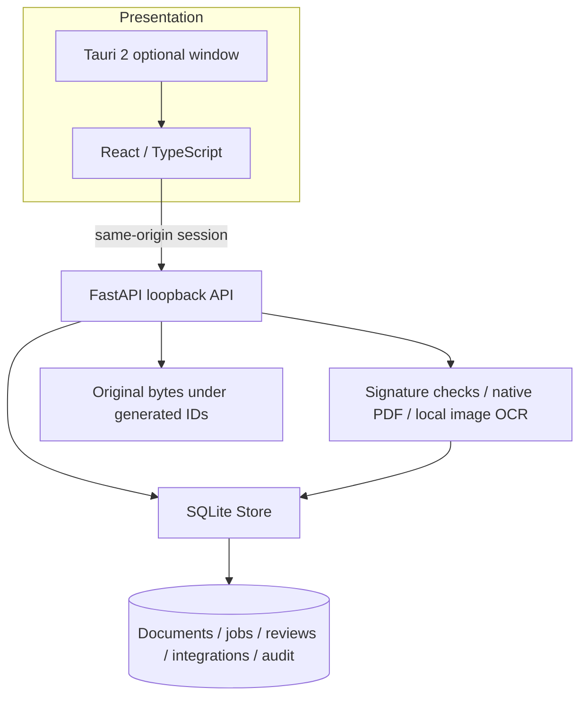

# Architecture

This implementation is authored independently from generic document-workflow requirements. It does not import any operational application's code or data. This engineering separation is not a legal opinion or automatic clearance for distribution.

`processing.py` owns format detection and labeled extraction. `store.py` owns transactions and persistence; `app.py` validates requests, state transitions and explicit integration authorization. `demo.py` generates new synthetic fixtures from literal text; `__main__.py` exposes the local commands. React keeps only current editing state in memory; saved extraction and decisions live in SQLite.

Documents retain an immutable original content hash. Processing increments a version and returns to `needs-review`. Decisions capture a full corrected field snapshot and preserve the extraction. Integration references a specific current approved review and is idempotent by unique review ID. A review of an earlier extraction cannot integrate after reprocessing. Transactions use `BEGIN IMMEDIATE` for state-sensitive decisions.

Jobs are synchronous HTTP operations recorded durably, not a background queue. Interrupted jobs become failed on service startup and can be retried. Use one server process per workspace; multiple simultaneous server processes over the same workspace are unsupported. The application recovers visible work state but does not claim distributed execution or tamper-proof auditing.
