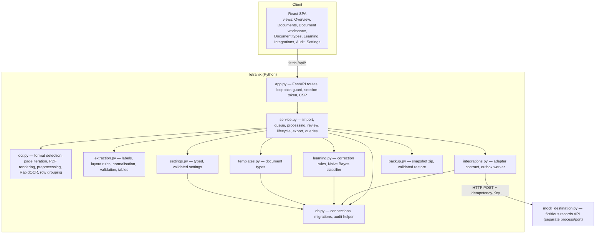
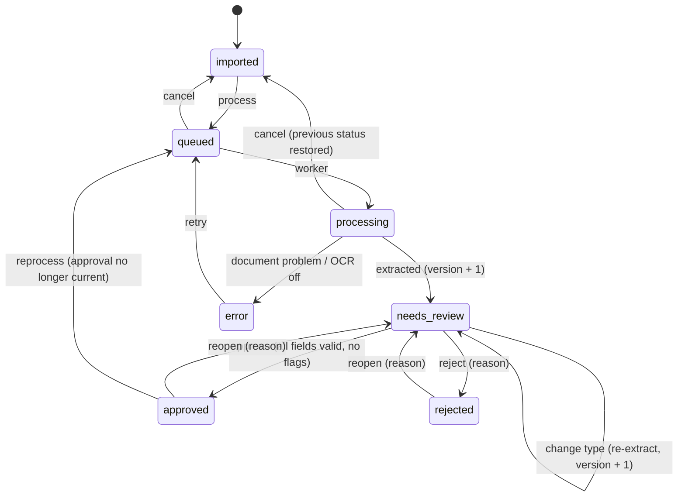
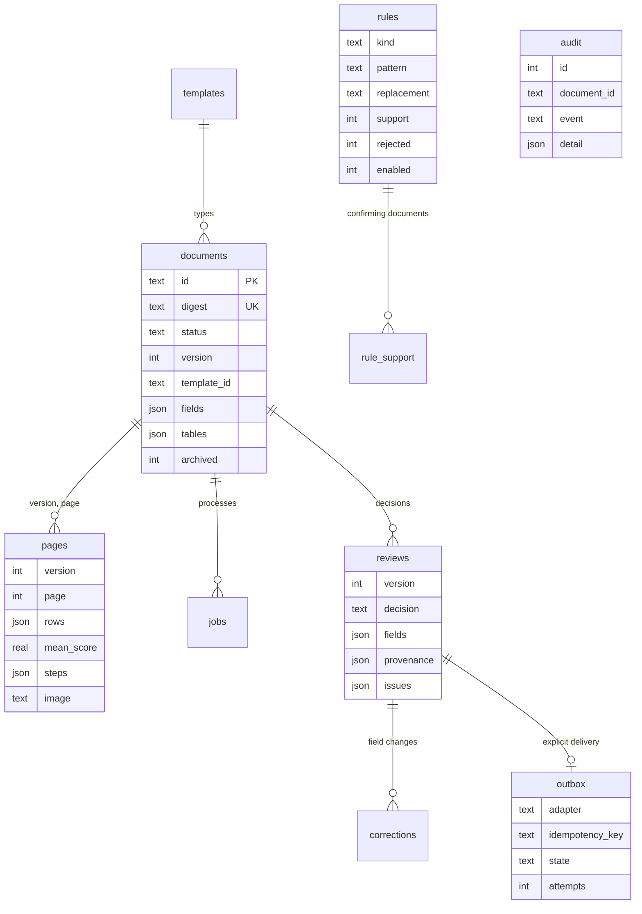
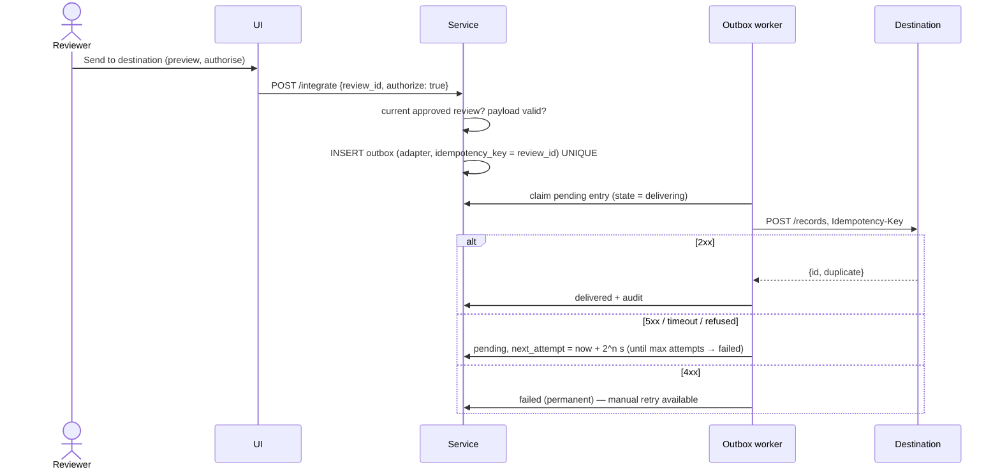

# Architecture

LETRANIX is a single-user, local-first application: a Python service bound to `127.0.0.1`, a React single-page app served from the same origin, and an optional Tauri window. All business rules live in the service layer; HTTP handlers only validate request shape.

## Components

| Module | Responsibility |
|---|---|
| `app.py` | Route definitions, request models (`extra=forbid`), error mapping (404/409/422/403), security middleware, static frontend. |
| `service.py` | `Letranix` facade: owns the database, settings, templates, classifier and both background workers. |
| `ocr.py` | Everything that touches bytes and pixels. Raises `DocumentError(code, message)` for user-facing problems. |
| `extraction.py` | Pure functions from page rows to fields; no I/O, fully unit-tested. |
| `learning.py` | Rule derivation inside the review transaction; classifier fitted from approved reviews and cached by a change key. |
| `integrations.py` | `Adapter` protocol, `LocalLedgerAdapter`, `HttpDemoAdapter`, payload contract, `OutboxWorker`. |
| `evaluation.py`, `benchmark.py` | Reproducible measurements used by the UI and the docs. |

## OCR and extraction pipeline

```mermaid
flowchart LR
  A[Upload / inbox] --> B{"Signature check<br/>(content, not extension)"}
  B -->|"empty, too large, corrupt,<br/>encrypted, too many pages"| R[422 with code]
  B --> C[Store original under generated id<br/>SHA-256 dedup, audit]
  C --> Q[(jobs: queued)]
  Q --> W[Job worker]
  W --> P{Per page}
  P -->|text file| N[Native text]
  P -->|"PDF page with ≥ 20 chars"| N
  P -->|"scanned PDF page"| RD[Render with pdfium at configured DPI] --> PRE
  P -->|"image / TIFF frame"| PRE["Preprocess: upscale, grayscale,<br/>median denoise, autocontrast, deskew"]
  PRE --> O[RapidOCR: boxes, text, score]
  O --> ORI{"vertical boxes<br/>or weak result?"}
  ORI -->|yes| ROT[Retry at 90/270/180°, keep best] --> G
  ORI -->|no| G[Group segments into rows]
  N --> G2[Rows]
  G --> CL
  G2 --> CL[Classify document type<br/>Naive Bayes + keywords]
  CL --> X["Extract fields: labels → learned aliases →<br/>unique-pattern inference (required only)"]
  X --> V["Normalise and validate,<br/>apply learned value/char maps"]
  V --> T[Line-item table]
  T --> S[(pages, fields, FTS index, timings, audit)]
```

Cancellation is checked between pages; a crash leaves the job `running`, which startup recovery re-queues once and then marks failed.

## Review state machine

Decisions carry the document `version`; a decision on a stale version returns 409, so two reviewers (or two tabs) cannot overwrite each other.

## Data model

`audit` and `ledger` deliberately have no foreign keys so history survives document deletion. A contentless-style FTS5 table (`search_index`) holds names, OCR text and field values.

### Migrations

`PRAGMA user_version` records the schema. Version 1 is the v0.1 schema (which did not set the pragma; it is detected from existing tables). Version 2 adds columns with defaults, rebuilds `audit` and the ledger without foreign keys, creates the new tables, indexes and the FTS index, then runs `PRAGMA foreign_key_check`. Each step runs in its own transaction; a newer schema than the build refuses to open. A real v0.1 workspace was upgraded in place during desktop testing, and `test_migration_from_v01_workspace` covers it.

## Delivery sequence

If the process dies between the destination accepting a record and the outbox being updated, the entry returns to `pending` on restart and the destination answers `duplicate: true` for the same key — covered by `test_retry_after_outage_and_idempotent_redelivery`.

## Concurrency

One job worker processes documents sequentially (the OCR engine is not re-entrant and is CPU-bound); one outbox worker delivers sequentially. Every write uses short `BEGIN IMMEDIATE` transactions on a WAL database with a 30 s busy timeout. Backup restore takes a re-entrant maintenance lock that both workers hold while working, so restore never races a job. One service process per workspace is supported.

## Desktop shell

`src-tauri/src/main.rs` checks whether a LETRANIX service answers on `127.0.0.1:8795` (verifying the `/api/health` product field, not just an open port). If not, it starts `.venv` Python with `-m letranix serve` hidden, waits for health, opens the window and kills the child on exit. `tauri.conf.json` grants no capabilities to the webview.
