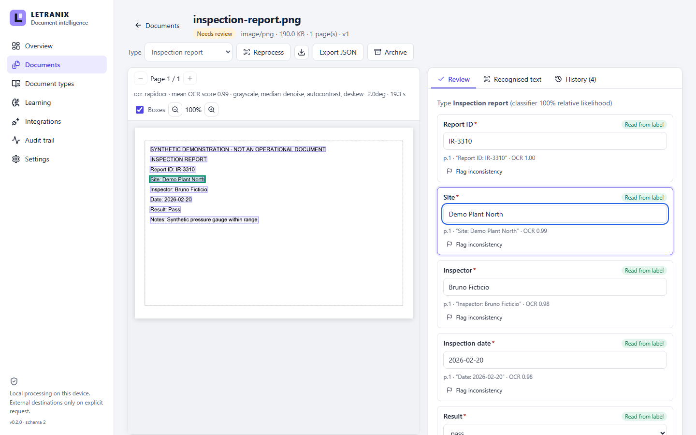

# LETRANIX — Plataforma de Inteligência Documental

**Do documento bruto ao dado revisado — no seu próprio computador.** O LETRANIX importa PDFs, digitalizações, fotos e textos, executa **OCR local**, extrai **campos tipados com evidência por campo**, submete cada resultado à **revisão humana assistida**, **aprende com as correções** de forma mensurável e entrega registros aprovados a sistemas externos por meio de uma **fila idempotente (outbox)**, com trilha de auditoria completa.

> Projeto de portfólio com código disponível. Nenhuma licença de código aberto é concedida. Todos os documentos, nomes e valores do repositório são sintéticos.



## O que funciona

- **Central documental**: importação por arquivo, arrastar e soltar ou pasta de entrada; deduplicação por SHA-256; busca de texto completo (FTS5) em nomes, texto do OCR e valores; filtros por tipo, status, data e pendências; processamento em lote; arquivamento e exclusão confirmada; exportação CSV/JSON.
- **OCR**: PDF (texto embutido ou páginas digitalizadas renderizadas), PNG, JPEG, TIFF multipágina, WebP e texto; pré-processamento medido (escala de cinza, contraste, redução de ruído, correção de inclinação, ampliação); correção de orientação 90/180/270°; fila em segundo plano com progresso, cancelamento e recuperação após falha.
- **Extração**: tipos de documento configuráveis; datas, identificadores, números, valores monetários e listas; rótulos com variações, acentos e espaços ausentes; formulários com valor abaixo do rótulo; tabelas de itens; nada é inventado — cada campo informa se foi **lido do rótulo**, **inferido** ou **não encontrado**.
- **Revisão assistida**: página com caixas do OCR e destaque da evidência; edição, candidatos, sinalização de inconsistências, rascunho preservado após recarregar, aprovação/rejeição com justificativa, reabertura e procedência por campo.
- **Aprendizado**: correções geram regras (novos rótulos, correções recorrentes, confusões de caracteres) com limiar de confirmação e desativação automática quando contrariadas; classificador Naive Bayes de tipos. **Medido em dados sintéticos: acurácia de campos 54,4% → 95,3%, zero valores inventados.**
- **Integrações**: contrato `letranix.record/v1`, outbox persistente, novas tentativas com backoff, chaves de idempotência, ledger local e adaptador HTTP real contra uma API fictícia incluída.
- **Auditoria, configurações, backup/restauração e migrações** versionadas do banco; **aplicativo desktop Tauri 2** que inicia e encerra o serviço local.

## Execução

```powershell
py -3.12 -m venv .venv
.\.venv\Scripts\python.exe -m pip install -r requirements-lock.txt
npm ci; npm run build
.\.venv\Scripts\python.exe -m letranix demo
.\.venv\Scripts\python.exe -m letranix serve --with-destination
```

Abra http://127.0.0.1:8795.

## Testes

75 testes de backend (incluindo OCR real offline, integração HTTP real, migração e backup) e 3 testes ponta a ponta no navegador aprovados localmente. Detalhes em [VALIDATION.md](VALIDATION.md); matriz de funcionalidades em [CAPABILITIES.md](CAPABILITIES.md).

## Limitações

O modelo de OCR às vezes omite espaços em textos grandes; caligrafia real não foi avaliada; o aprendizado é baseado em regras e estatística (não em rede neural) e foi medido apenas com dados sintéticos; uso monousuário sem criptografia de armazenamento; o desktop depende do `.venv` do projeto e a distribuição de binários segue bloqueada por um aviso de dependência Rust de compilação. Direitos de distribuição: ver [THIRD_PARTY.md](THIRD_PARTY.md).
